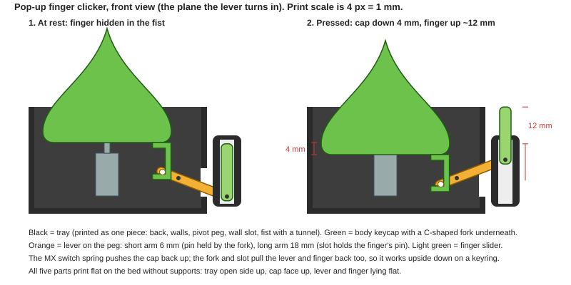

# Pop-up finger clicker (the "rude raindrop")

A character clicker where pressing the top of the character makes a hidden middle finger (or a
thumbs-up, a wave, a heart) pop out of its fist, then drop back when you let go. Asked for in the
"3D Printing Files" Facebook group (Nov 2026); the generic version is a Seller-tier magnet because
any traced character can be the body.

Short answer: **yes, we can do it with the existing Clicker Maker.** The *Shape clicker* already
turns a picture into a button on an MX switch inside a tray. We add one hidden lever and a sliding
finger. No springs, no screws, no glue: one MX switch plus five printed parts.

## How it works (plain words)

1. The whole character body is the **keycap**, exactly like today's Shape clicker. The MX switch
   under it gives the click and the return spring. A key press travels **4 mm** (Cherry MX data).
2. Under the body, near the side where the arm is, the keycap has a small **C-shaped fork**.
3. Inside the hollow tray sits a flat **lever** on a printed **peg** (the pivot). The fork holds the
   lever's short end (6 mm from the peg). The lever's long end (18 mm from the peg) pokes through a
   slot in the tray wall into the **fist**, which is part of the tray.
4. The **finger** is a flat slider in a tunnel through the fist. A little pin on its foot sits in a
   slot at the end of the lever.
5. Press: the cap goes down 4 mm, the short end goes down 4 mm, so the long end goes up 3 times as
   far: the finger pops **about 12 mm** out of the fist. Let go: the switch spring pushes the cap up,
   the fork pulls the lever back, the lever slot pulls the finger down. Because every joint is held
   both ways, it also works upside down on a keyring (no reliance on gravity).

Why a lever and not a gear: 4 mm of travel is too little to look like anything on its own. A 3:1
lever is the simplest print-friendly multiplier, and it has no tiny teeth to fail at 0.4 mm nozzle.

## Numbers to start from (all unverified until printed)

| What | Value | Why |
|---|---|---|
| Key travel | 4.0 mm | Cherry MX full travel |
| Short arm (peg → fork pin) | 6 mm | 4 mm over 6 mm = ±21° swing, no binding |
| Long arm (peg → finger pin) | 18 mm | 3:1, gives 12–13 mm pop |
| Lever thickness | 3 mm, lying flat | stiff, prints flat |
| Peg | Ø 4 mm, lever hole Ø 4.4 mm | 0.2 mm radial clearance |
| Fork / slot width | pin + 0.5 mm | pins are Ø 3 mm, slots 3.5 mm |
| Finger slider | 6 mm wide × 3 mm thick, 20 mm long | fits a 7 × 3.6 mm tunnel (0.3 mm per side) |
| Fist (arm pod) | ≈ 14 mm wide, 25 mm tall | holds the 20 mm finger plus a stop so it cannot fly out |
| Body size | 55–65 mm tall | needs the switch's 20 mm solid area under the face and room for the arm |
| Switch | MX Red/Brown (45–55 gf) to start | if the pop feels mushy, MX Black (60–80 gf) |

Force check: the 3:1 lever means any friction at the finger is felt 3× at the cap. The finger
weighs about 1 g, so friction is the only load; keep the tunnel smooth (print the finger lying
flat so the sliding faces are layer tops, not stepped walls). If it sticks, drop to 2:1 (long arm
12 mm, ~8 mm pop) before changing anything else.

## Print orientation (keeps the "no supports" rule of the Clicker Maker)

- **Tray**: open side up, as now. The peg stands up from the floor, the wall slot is a vertical
  gap in the wall, the fist tunnel runs parallel to the bed with a 45° peaked roof (same trick as
  the stackable blocks' cord tunnels).
- **Body keycap**: face up, as now; the fork hangs down from the underside and is only 3 mm tall,
  so it prints as a short vertical wall.
- **Lever** and **finger**: lying flat, pins pointing up (tiny vertical cylinders).

Assembly, in order: switch into the sleeve → lever onto the peg → finger into the tunnel from
the tray side (pin into the lever slot) → keycap onto the switch (its fork drops over the lever
pin). The cap keeps the lever from lifting off the peg; the fist's lip keeps the finger in.

## The art: how to get the character into three pictures

The tracer in the Clicker Maker (the hub's image-to-multicolor playbook) already turns a cartoon
like the raindrop into flat printable colours. The one new thing is that the arm must be its own
pieces. Ask the image tool for (or paint out in any editor):

1. **Body** without the right arm: drop, face, left fist, feet. → becomes the keycap picture.
2. **Fist** (the right hand closed, knuckles up) → the outline of the arm pod on the tray, with the
   green/black colours as a relief on its face.
3. **Finger** (a single raised finger with its outline) → the face of the slider.

Keep each picture to ≤ 4 colours (green, dark green outline, white highlight, black) so the whole
toy prints with the AMS/ACE slots the clicker already assigns. The fist and finger share the
tray/keycap colour roles (`@base`, `@cap`, `@letter`) like charm layers do today.

Ship a family-friendly hand set too (thumbs-up, wave, heart, peace, "OK"): same mechanism, and
MakerWorld moderation is safer with those as the free mirror.

## Where the code goes

All of this lives in the **clicker repo** (`clarkstyx/clicker`), not the hub. The hub only lists it
and pulls the build.

1. `src/geometry/popup.ts`: given the tray outline, the side (left/right) and the three pictures,
   returns extra geometry for the tray (peg, wall slot, arm pod with tunnel and lip), the fork on
   the keycap, and two new parts `LEVER` and `FINGER`. Expose `stroke` (mm of pop) for the UI.
2. `params.ts`: a `popup` setting on the Shape clicker: `off | right | left`, hand set id or
   uploads, and three fit numbers (pin clearance, tunnel clearance, peg clearance).
3. Preview: a third pose "Pressed" next to Assembled / Print plate (cap down 4 mm, lever rotated,
   finger up), so Clark can see the pop before printing.
4. Tests, same style as the phone stand's hinge tests: lever never touches the tray or cap except at
   the fork pin and peg; finger never touches the tunnel walls at rest or pressed; `minDistance`
   ≥ clearance; stroke ≥ 10 mm; every part flat on the bed with no overhang past 45°.
5. Export: the zip already groups by colour; add `LEVER` and `FINGER` to the base-colour plate.

## Steps, in order

1. **Mechanism coupon first, no art.** A plain round button on today's tray plus the peg, lever,
   tunnel and a plain finger. Three copies with pin/tunnel clearances 0.25 / 0.30 / 0.35 mm.
   Print, note which one pops and returns on its own in every orientation, log it in
   `PRINT_VALIDATION.md`. Everything else waits on this one print.
2. Add `popup.ts` + tests + the Pressed view in the clicker repo, using the clearance that won.
3. Make the three raindrop pictures, trace them, print the real thing. Tune the fist lip and
   the finger length so the tip stays hidden at rest.
4. Add the hand set, update the clicker README and `vendor/docs/clicker/`, run `npm run pull clicker`.
5. Launch (see the launch-checklist skill): the raindrop as the MakerWorld free fixed model
   linking here, the "any character + any hand" version behind the Seller tier. Reply to the
   Facebook post with the MakerWorld link once it prints.

## Prior art looked at

Existing designs are either print-in-place collapsing fingers (3DGeex "Collapsing Middle Finger",
MyMiniFactory 360399) with no button, lid-triggered gift boxes, or TPU-spring snaps. Nothing
found that drives the finger from a keycap switch, which is the point of ours: the MX click is the
feel people buy the clicker for.
